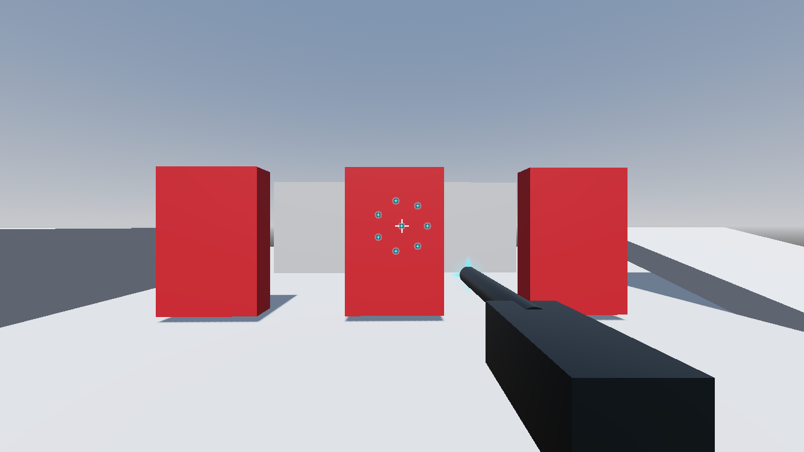
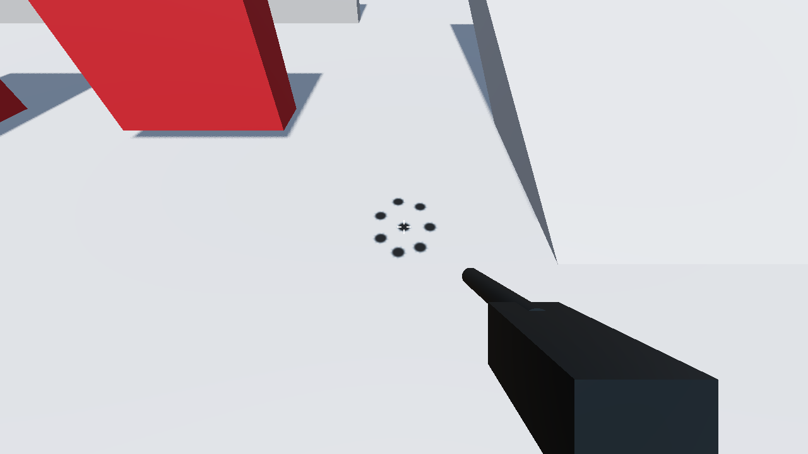
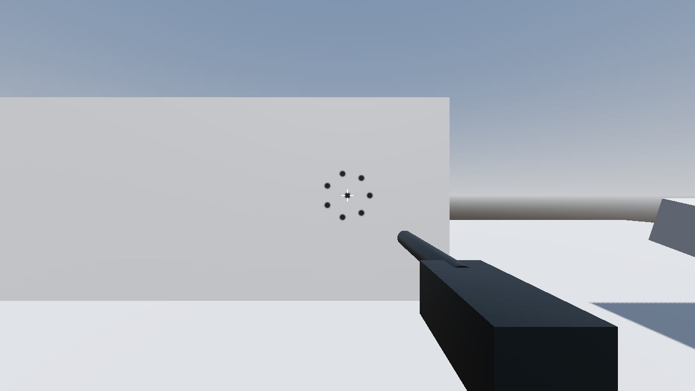

# Журнал работ Rogue Calibre

Датированные существенные решения и результаты. Текущий план — в [roadmap.md](../../roadmap.md),
открытые долги — в [follow-ups.md](follow-ups.md), гарантии API — в [contracts.md](../contracts.md).
Локальная проверка и независимое ревью не означают публикацию, прохождение GitHub CI или слияние.

## 2026-10-13 — назначение визуальных пулов M1

После отдельной приёмки пакета3 координатор назначил пакет4 единственному lead writer
в `codex/m1-visual-pools` от `d9f1a53175fe32176fac72df195eda27ee18a129`.
Принят только visual preset: lifetime3/6/180physics, sizes0.16/0.08/0.14м,
depth0.04м, pools5/40/80 по burst4+ceil(L/30) для одного producer/stride8.
Предсозданные mesh flashes и настоящие Decal используют две shared cold bitmap
textures64x64; budgets128nodes/32KiB raw textures/16KiB packed presentation state.
Physical snapshots после publish отделены от pure damage; overflow визуала
не меняет shot/cooldown/damage. Рендеринг и expiry вне deterministic guarantee.
Договор записан до реализации. Координатор подтвердил prerequisite CI точного
base `d9f1a53`: Linux/Windows SUCCESS, GitHub run38424601880, completion
15:48:43/15:49:07UTC. Это проверка базы, не packet4 HEAD.

Первый focused прогон: 27/27 (pool7/Jolt17/Sandbox3), active3900ticks подтвердил
120 muzzle/960 impact/960 marks и2040 reused/2040 expired; object/node/resource/
orphan/static delta0, visual config/dropped0, shots120/hits960/resolved120 сохранены.
Negative orphan probe обнаружен и очищен. Первое discovery обнаружило ошибку
размещения последних assert в Sandbox test; scope исправлен до этого PASS.
После focused PASS добавлены два boundary tests (mark-full/impact-free и generation
40000>Int32), диагностика publish rejection; они ещё ожидают итогового all.
Ignored native-smoke.gd подготовлен для графической Forward+/D3D12 inspection.
Первый native smoke после исправления ignored helper на normal Node scene
подтвердил Forward+/D3D12 на NVIDIA RTX4050LaptopGPU, 1280x720, visible target/wall/
floor marks, отдельные flashes и reset. Это pause-capture, не live interpolation
или OS input/FPS test. Architect early audit выявил interpolation risk при reuse
IDENTITY→contact и raw socket frame following. До all внесён cold modeOFF для pool/
nodes и cold interpolation-pump priming; muzzle теперь следует interpolated
display socket, getter вызывается каждый presentation frame. Focused pool10+
ShotBatch6 =16/16 PASS после этого fix. Ignored helper расширен live unpaused
moving-camera shot; повтор native именно исправленной версии ожидается.
API основание fix: [Godot Node3D interpolated transform](https://docs.godotengine.org/en/stable/classes/class_node3d.html#class-node3d-method-get-global-transform-interpolated)
и [physics interpolation guidance](https://docs.godotengine.org/en/stable/tutorials/physics/interpolation/using_physics_interpolation.html).
Повторный native smoke исправленной версии: exit0, stderr empty, actual NVIDIA
RTX4050LaptopGPU, D3D12/Forward+,1280x720. Live unpaused moving-camera shot имеет
active1/8/8, muzzle displayed pose error0.00000000 и mode2OFF; восемь cyan contacts
видимы на target. После expiry active0/0/8, marks остаются world-anchored при движении
камеры. Wall NO_HANDLE и floor marks видимы отдельно от flash, оба reset дают0/0/0.
Координатор независимо просмотрел PNG и проверил ROI2px sampling: baseline→shot
changed305/cyan27 samples, baseline→marks dark96; blank renderer исключён.
Viewport renderCPU/GPU snapshots и video bytes записаны в ignored native stdout;
image capture I/O повышает TIME_PROCESS, это не FPS или7ms real-combat измерение.
OS input/ручная плавность не проверены. Actual corrected-version proofs:





### Итоговая локальная проверка пакета4

Final Windows `ci/run_checks.sh all` с LOG_DIR=`ci-logs/visual-pools` завершился
exit0: import PASS, scripts64/0,249/249 tests в32suites,0errors/failures/flaky/
skipped/orphans. Итоговая версия включает boundary generation40000>Int32,
mark-full/impact-free, publish rejection и interpolation fix; ранние ожидаемые
результаты выше теперь закрыты. ShotVisualPool10/10, ShotgunPhysics18/18,
ShotBatch6/6, ShotgunSandbox3/3, FPS16/16, MobilityPhysics30/30 PASS.
Логи `ci-logs/visual-pools/{import,scripts,tests,regress}.log`, XML/HTML report_3
сохранены локально и исключены из коммита.

Активный настоящий Jolt/weapon/resolver/pool прогон после300warmup измерил3600ticks:
120shots/960traces/960hits/120resolved;120muzzle/960impact/960marks,
2040reuse/2040expiry; objects/nodes/resources/orphans/static deltas0,
combat configuration0, visual configuration/dropped0. Counters сняты до assertions.
Отрицательный injected-orphan case обнаружил objects+1/orphans+1 и очистил probe.
Synthetic regress сохранён отдельно: checksum3032385286 PASS, dropped0/config0,
object/node/resource/orphan/static deltas0;1800logic samples avg693us/max1244us,
wall2173ms. Выводимая CPU метрика не является порогом real-combat7ms.
Прежние golden references не менялись; все golden suites входят в249/249.

После этих прогонов обновляются только шесть MD с actual results; runtime/config/
project assets не менялись и Godot повторно не запускался. Проверяются Markdown,
новые относительные ссылки/anchors, согласованность и `git diff --check`, затем
полный code/tests/docs/PNG snapshot передаётся независимому reviewer по raw hashes.
Independent final-diff acceptance ещё не получена: пакет4 не принят; commit/push/
PR/CI/merge текущей версии отсутствуют. CI базы `d9f1a53` не валидирует этот diff.
Пакет5/M2 не начаты. Ручные OS input/плавность/60FPS и real-combat≤7ms с40enemies
и effect storms остаются неподтверждёнными; native smoke и headless не закрывают их.
Пользователь отдельно поручил после завершения пакета4 разобрать и слить PR,
затем подготовить тестовую сцену с дробовиком/мишенями; это последующие назначения,
а не выполненная публикация, слияние или расширение текущего пакета.

### Независимая локальная приёмка пакета4 — 2026-10-13

Независимый архитектурный reviewer `/root/packet3_final_review` и независимый QA
`/root/docs_review` дали PASS без блокеров точному итоговому23file snapshot от базы
`d9f1a53175fe32176fac72df195eda27ee18a129`. Raw manifest SHA256:
`6b2b03d9e2008b6e0a246d410a028f161ed4bcbe2940be6e2ad10f2f088c7549`;
tracked patch SHA256 `e4d104097aef6017614056f62ee9cdb72116c194cd756638107217065569ad88`.
Manifest включает новые code/UID/tres/PNG, не только tracked diff. QA сопоставил
source, итоговые логи/XML и native PNG; тяжёлый runtime-прогон не повторял.
Координатор сверил exact staged files и создал source commit
`ff26428d51c024ad693c916982738d96fba4096d` в `codex/m1-visual-pools`.
Пакет4 принят локально; предшествующий статус «ревью ожидается» выше сохраняется
как история до этих verdict. Это не приёмка всей M1: пакет5/ручные OS input/
плавность/60FPS/real-combat7ms остаются открыты. PR/CI/merge пакета4 ещё нет.

Текущий шаг меняет только шесть MD, записывая фактические PASS/source/status;
runtime/config/assets сохранены и Godot повторно не запускался. Новая docs-only
запись проходит Markdown/links/anchors/diff-check и отдельное независимое ревью
точных bytes перед фиксацией. Прежние PASS не одобряют изменённые MD автоматически.

## 2026-10-11 — процесс, окружение и устранение двух долгов M1a

### Решения и окружение

- Создан [AGENTS.md](../../AGENTS.md): основной агент — координатор, реализация делегируется
  исполнителям, каждое изменение и точный итоговый diff проходят отдельное независимое ревью.
  Координатор работает на `medium`, все субагенты, включая ревьюеров, — на `high` с явным
  `reasoning_effort="high"`; ограничения наследования истории учитываются через `fork_turns="none"`.
- Найден Godot 4.7.2 Mono: `C:/Program Files/Godot/Godot_v4.7.2-stable_mono_win64_console.exe`.
  В глобальную конфигурацию Codex добавлен MCP `@coding-solo/godot-mcp`: проверены 14 доступных
  инструментов и ответ `get_godot_version`. Конфигурация и секреты в журнал не копируются.

### Устранённые долги и ревью

- `StatBlock.set_state()` проверяет типы всех восьми обязательных полей до приведений и
  изменения состояния. Некорректный снимок даёт `push_error` и `false`, полностью сохраняя
  прежнее состояние. Добавлены семь тестовых случаев для отсутствующих/null-полей,
  числовых строк, float/bool-счётчиков, обычных массивов и неверных типов packed-массивов;
  тесты проверяют атомарность отказа. [Контракт](../contracts.md) обновлён.
- Добавлены независимые Python-модели `fixed_ref.py`, `hit_event_queue_ref.py`,
  `seeded_rng_ref.py`, `stat_block_ref.py` в `3d-shooter/tests/tools/`. Golden-значения
  сохранены; шапки соответствующих тестов указывают модели. Итоговые выводы моделей
  совпали с существующими эталонами: Fixed `1272520513`, HitEventQueue `4173027423`,
  StatBlock `1088715370`; SeededRng подтвердил векторы, хеши и подпотоки.
- Исходный прогон был 131/131 в 21/21 suite; новые тесты на прежнем `StatBlock`
  выявили 13 runtime errors и 56 failures (23 теста, exit code 100).
  Источники — локальные `ci-logs/baseline/tests.log` и
  `ci-logs/regression-proof/old-statblock-all.log` в worktree `codex/statblock-state-types`.
- Исходные изменения и интеграция получили независимый итог «блокеров не найдено»
  от ревьюеров на `high`. Правки разных областей документации сведены в итоговую версию.
  Пользовательские изменения `project.godot` и существовавшие `.cs.uid` сохранены.

### Итоговые локальные проверки исходных изменений на Windows

Godot `4.7.2.stable.mono.official.ed1daf0bf`: импорт успешен, проверены 41 скрипт,
ошибок 0; gdUnit4 — 138/138 тестов в 21/21 suite, errors/failures/flaky/skipped/orphans — 0.
Бенчмарк `regress.gd` — PASS: checksum `3032385286`, dropped payloads и config errors — 0;
дельты objects/nodes/resources/orphans и static memory — 0. За 1800 логических тиков
среднее 897.4 мкс, максимум 6510 мкс. Указанный в текущем синтетическом бенчмарке бюджет
7000 мкс пока не является жёстким порогом до M3; этот прогон не подтверждает готовность M3.
Выводы четырёх Python-моделей совпадают с golden-эталонами.

База исходных веток — `36b171d9699064dc3ef40552709310272e3492e0`:
`codex/statblock-state-types`, `codex/golden-reference-models`, `codex/agent-workflow`.
Версия 13 исходных изменённых файлов зафиксирована в локальном
[SHA256-манифесте](../../ci-logs/integration/file-hashes.sha256).
[Логи интеграции](../../ci-logs/integration/) (`import.log`, `scripts.log`, `tests.log`,
`regress.log`, `references.log`) — локальные вспомогательные материалы; сырые логи
игнорируются Git и могут отсутствовать в другом checkout. Краткие результаты приведены выше.

### Статус и следующий шаг

Изменения остаются локальными: commit/push/PR не выполнялись, слияния нет. Linux и GitHub CI
для этой версии не проверены. M1 ещё не начата.

При перечитывании после итогового ревью найден незакрытый стык: общий контракт требует
однократный `push_error` при переполнении буферов, а `DamagePayloadBuffer.gd:9–11,69–72`
явно не логирует отказ, только возвращает `INVALID_SLOT` и повышает `dropped_count()`.
Это нарушение контракта внесено в [follow-ups.md](follow-ups.md) с приоритетом до M1;
прежнее ревью и зелёные тесты не устраняют найденное расхождение. Следующий шаг — согласовать
реализацию и семантику сброса уведомления с контрактом, добавить регрессионный тест и пройти
независимое ревью. Затем оформить текущие изменения по Git-потоку с ревью точной публикуемой
версии и обязательными CI, затем выполнять пакеты подготовленного плана M1 при выполнении prerequisites, учитывая четыре
открытых пункта follow-ups. [Пошаговый план M1](../m1-plan.md) описывает пять последовательных
пакетов с критериями приёмки; реализация не начата, новые игровые параметры не утверждены.

### Обновление документации

Все семь исходных MD перечитаны. В AGENTS.md и [CLAUDE.md](../../CLAUDE.md) закреплено
ведение затронутых документов после каждого логического шага до итогового отчёта;
дорожная карта получила локальный статус M1a и ссылку на план M1, follow-ups — историю
устранённых долгов и новый открытый стык. В техническом манифесте исправлено имя ветки
слияния на `master`; в контрактах уточнено существующее разделение чистой логики,
физического адаптера и визуала, включая вызов `try_activate()` и изменение ENERGY.
Общий контракт переполнения сохранён. Геймдизайн и runtime не менялись. Отдельный docs-only
diff восьми файлов 2026-10-11 получил независимый итог «блокеров не найдено» от ревьюера
на `high`. Рассмотрена delta восьми MD,
SHA256 `E1318A3F5BA99045B552D0140FB211AE6143828CE72D3500BB68A1E76EBFDA11`.
Результат относится только к этой версии MD; он не подтверждает ревью кода, Linux или
GitHub CI. Настоящая запись результата и итоговый перенос требуют отдельной независимой
проверки; одобрение рассмотренной delta на них автоматически не распространяется.

Самопроверка рассмотренной версии документации пройдена: изучен diff относительно сохранённых копий текущего
checkout; проверены 39 относительных ссылок без ошибок (две ссылки на логи доступны только
в основном checkout); проверки whitespace всех восьми файлов и `git diff --check` успешны.
Godot для этой правки MD не запускался;
сведения о runtime-проверках выше относятся к предыдущей интеграции исходных изменений.

## 2026-10-11 — подготовка foundation checkpoint (этап подготовки)

По новому поручению пользователя разрешены commit текущего состояния и публикация PR.
Создана ветка `codex/foundation-checkpoint`, готовится draft PR в `master`; commit, push и PR
ещё не выполнены. Автоматическое слияние не разрешено. Прежние записи об отсутствии PR
описывают состояние до этого поручения.

Свежий `origin/master` проверен через fetch: база
`36b171d9699064dc3ef40552709310272e3492e0`. В отдельный чистый worktree перенесён точный
снимок 20 файлов из основного checkout: 12 tracked и 8 untracked. Он включает изменения
StatBlock и его тестов, четыре Python-модели и golden-шапки, документацию процесса,
контракты, roadmap, follow-ups, журнал и план M1. По поручению сохранить текущее состояние
включены также ранее существовавшие Godot-метаданные: `project/assembly_name="Rogue Calibre"`
в `project.godot` и `GdUnit4CSharpApi.cs.uid`. Кэши `.godot`, отчёты, сырые логи и секреты
в публикуемый снимок не входят. Исходные копии и SHA256 сохранены локально в
`ci-logs/checkpoint/before/`; основной checkout не изменён.

Независимое ревью исходных изменений, docs-only delta восьми MD и последующее итоговое
ревью интеграции документации завершены с результатом «блокеров не найдено».
Новая версия checkpoint из 20 файлов, включая метаданные и эту запись, ещё требует
отдельного независимого ревью перед commit/push/PR. Ранее выполненные локальные Windows-
проверки сохранены без повторного запуска, поскольку runtime-байты не изменены:
импорт успешен, скрипты 41/0, тесты 138/138 в 21 suite, `regress.gd` PASS,
checksum `3032385286`, дельты objects/nodes/resources/orphans и static memory — 0,
dropped/config errors — 0. Linux и GitHub CI для checkpoint ещё не выполнялись.

Изменения новой подготовки ограничены записью этого этапа в журнале, roadmap и плане M1.
Исправление известного расхождения `DamagePayloadBuffer` с общим контрактом остаётся
открытым долгом до M1; новый runtime-код и реализация M1 не начаты. Draft PR фиксирует
текущий снимок и не объявляет его готовым к merge.

Самопроверка подготовки: все 20 файлов основного снимка сохранены без изменений;
17 файлов checkpoint совпадают с ним, три MD обновлены только для нового этапа.
Runtime-файлы совпадают побайтно. Проверены 40 относительных ссылок без ошибок
(две ссылки на integration-логи доступны только в основном checkout); проверки whitespace
новых файлов и `git diff --check` успешны. Полный diff относительно базы, delta трёх MD,
SHA256-манифест и текст draft PR сохранены локально в `ci-logs/checkpoint/` для ревью.

## 2026-10-12 — поручение опубликовать текущий checkpoint

Пользователь подтвердил commit, обычный push и draft PR текущего состояния и явно
поручил пропустить дополнительное ревью упаковки этого checkpoint. Это однократное
исключение для публикации текущих 20 файлов и записи результата; постоянные правила
AGENTS.md и требования последующей разработки сохраняются. Прежние независимые ревью
относятся только к рассмотренным тогда версиям: полный публикуемый checkpoint из
20 файлов не объявляется независимо проверенным. Слияние не поручено.

Перед публикацией проверены фактические Git-состояние и GitHub: branch
`codex/foundation-checkpoint`, HEAD всё ещё базовый `36b171d9699064dc3ef40552709310272e3492e0`,
remote-ветки и PR нет. Дублировать публикацию не требуется. Далее — commit/push/draft PR,
затем запись фактических commit/URL и известного CI-статуса. Runtime и Godot-метаданные
не меняются, Godot-проверки без новых изменений кода не повторяются. Открытый overflow-
долг остаётся до M1, дальнейшая реализация в этот шаг не входит.

### 2026-10-12 — checkpoint опубликован

Создан commit `eb2415b6eb9581476d1aac89571f06147ffb530c`
(`M1a: harden saved state and restore golden references`), выполнен обычный push
ветки `codex/foundation-checkpoint`, открыт
[draft PR #8](https://github.com/GrehBan/3d_shooter/pull/8) в `master`.
PR в состоянии OPEN/DRAFT; слияние не выполнялось и не поручено. Публикация текущего
checkpoint выполнена; прежние noPR/pending-записи выше относятся к указанным там этапам.

Дополнительное ревью упаковки 20 файлов и этой записи пропущено только по явному
поручению пользователя. Прежние результаты независимых ревью не распространяются
на весь публикуемый снимок. Постоянная политика AGENTS.md не изменена.
На момент публикации обе обязательные проверки `Tests and benchmark (ubuntu-latest)`
и `Tests and benchmark (windows-latest)` для исходного commit находятся IN_PROGRESS:
[CI run 38192312429](https://github.com/GrehBan/3d_shooter/actions/runs/38192312429).
Зелёный итог Linux/Windows ещё не подтверждён; новый HEAD после docs-only записи
публикации требует проверки его собственного CI, результаты старого SHA его не заменяют.

После публикации обновлены только журнал, roadmap и план M1; runtime-байты сохранены,
Godot повторно не запускался. Известное расхождение переполнения DamagePayloadBuffer
остаётся открытым до M1; новый runtime-код не начинался. Эта запись отправляется отдельным
docs-only commit `docs: record foundation checkpoint publication` без дополнительного
ревью по тому же однократному исключению.

## 2026-10-12 — согласование переполнения DamagePayloadBuffer с контрактом

### База и состояние публикации

После завершения публикации checkpoint обе обязательные проверки GitHub CI
`Tests and benchmark (ubuntu-latest)` и `Tests and benchmark (windows-latest)`
получили SUCCESS для итогового HEAD `3dfddbf0c50bbedcd1aaadaf2036f25236dd59f9`.
[PR #8](https://github.com/GrehBan/3d_shooter/pull/8) остаётся OPEN/DRAFT, merge не выполнялся.
Это уточняет прежнюю запись IN_PROGRESS на момент первой отправки; зелёный CI этой базы
не относится к новому исправлению ниже.

Координатор согласовал зависимую базу `3dfddbf` для ветки `codex/buffer-overflow-contract`
в отдельном worktree. Пользовательские изменения основного checkout не переносились.
Исправление выполняется до M1; её реализация не начата. Однократное исключение ревью
предыдущей публикации не распространяется на этот шаг: требуется независимое ревью
точного нового diff, включая документацию.

### Исправление и история закрытого долга

Расхождение, найденное 2026-10-11 и ранее записанное в [follow-ups.md](follow-ups.md),
исправлено локально. `DamagePayloadBuffer.push()` сообщает об ошибке переполнения
один раз до ближайшего `clear()` / `reset_dropped_count()`. Каждый отказ по-прежнему
возвращает `INVALID_SLOT` и повышает счётчик, сохраняя записи и FIFO. `clear()` очищает
очередь и уведомление, сохраняя dropped; `reset_dropped_count()` сбрасывает счётчик и
уведомление, сохраняя очередь. Успешный push/pop уведомление не сбрасывает. Реализация
добавляет только bool и ветку первой диагностики; новые контейнеры или logger отсутствуют.
[Контракт](../contracts.md) закрепляет оба сброса; остальные открытые долги сохранены.

Unit-тесты сравнивают все поля записей, слоты и порядок, проверяют первое уведомление,
тишину повторных отказов, оба сброса и отсутствие нового уведомления после опустошения
через pop. Существующая трасса детерминизма сохранена, добавлены проверки её размера
и 22 отказов; успешный hot-path тест сохранён, подавленные отказы измеряются отдельно.
Точный count захваченных сообщений проверяется через приватный logger закреплённого
gdUnit4 6.2.1, только в test helper: стандартный is_push_error проверяет лишь наличие.
Addon не менялся; при обновлении gdUnit этот helper нужно сверить с его API.

### Самопроверки и ограничения

Импорт базы успешен, scripts — 41 проверен, ошибок 0. Целевой suite — 13/13,
errors/failures/flaky/skipped/orphans — 0, exit 0. Контролируемые отрицательные проверки
дали ожидаемый exit 100: прежний код без уведомления — 18 failures, вариант с двумя
push_error — 9 failures, во всех 13 тестах; runtime errors и orphans — 0 в обоих прогонах.
Вторая проверка падает именно на count 2 вместо 1. После каждой подмены итоговые runtime-
байты восстановлены с проверкой SHA256. Golden-значения не менялись.

SHA256 runtime-версии:
`DamagePayloadBuffer.gd` — `A78FC5BDA7F2B8C8F7F637CF7E710C7F3853C37445540A9F24FC0BCC25250267`;
`DamagePayloadBufferTest.gd` — `AC5CD219CE5B8ABEA0D68460A6EEB474B2C813E8D9E323F0DC5DC866C9646E80`.
Полный финальный `ci/run_checks.sh all` на Windows завершился exit 0: импорт успешен,
41 скрипт без ошибок; unit/golden — 142/142 в 21/21 suite, errors/failures/flaky/skipped/
orphans — 0. Бенчмарк PASS: checksum `3032385286`, dropped/config errors — 0,
дельты objects/nodes/resources/orphans/static memory — 0; 1800 логических тиков,
среднее 589.9 мкс, максимум 1082 мкс. Успешные и подавленные overflow hot-path тесты
подтвердили objects/memory delta 0. Первая ожидаемая диагностика выполняется до замера,
чтобы перехват ошибок gdUnit не искажал метрики. Синтетический benchmark по-прежнему
не применяет CPU-бюджет 7000 мкс как жёсткий порог и не подтверждает плавность/FPS M1.
После этого обновлены только результаты в журнале, runtime-байты сохранены.
`git diff --check` успешен; проверены 29 относительных ссылок затронутых MD:
ошибок 0, две прежние ссылки на integration-логи намеренно локальные и отсутствуют
в этом worktree (это ограничение описано в записи исходной интеграции).
Логи этого шага сохраняются локально в `ci-logs/overflow-contract/` (baseline, targeted,
proof, final); краткие факты выше не требуют наличия этих игнорируемых материалов.

На момент завершения самопроверок новый diff ещё ожидал независимое ревью;
commit/push/PR не выполнялись, Linux и GitHub CI исправления не запускались.
Приёмка prerequisites из
[плана M1](../m1-plan.md) не заменяется SUCCESS предыдущего checkpoint.

### Независимое ревью и принятие 2026-10-12

Отдельный ревьюер на `high`, не участвовавший в реализации, проверил полный diff
семи файлов относительно `3dfddbf0c50bbedcd1aaadaf2036f25236dd59f9` и дал итог
«блокеров не найдено» (PASS). SHA256 рассмотренного patch:
`673DF54CDE66393A51730A25CA57D5A1F955A29669CF9F8A1B02C8FBD7AC2EC1`.
Подтверждены runtime/test-хеши, указанные выше, итоговые логи 142/142, нулевые
allocation delta и отрицательные доказательства с 18/9 failures.
Исправление переполнения принято локально.

После этого изменены только журнал, roadmap и план M1 для записи результата;
runtime, тесты, контракты и follow-ups сохранены побайтно. Godot не запускался повторно.
Эта metadata-запись и её точный diff проходят отдельный просмотр тем же независимым
ревьюером; PASS исходного семифайлового diff на новые байты MD автоматически не переносится.
Подготовлено краткое описание следующего самостоятельного draft PR в `master`.
Checkpoint PR #8 остаётся неизменным, OPEN/DRAFT и не слит; новая ветка зависит от его
HEAD `3dfddbf`, поэтому будущий master-diff пока включает checkpoint и это исправление,
а новое изменение относительно зависимой базы ограничено семью файлами.

Статус до публикации новой задачи: исправление независимо проверено и принято локально;
публикации, commit/push/PR и Linux/GitHub CI для него ещё нет. Следующий шаг — завершить
metadata-review и передать координатору подготовленную версию для решения о публикации.
Слияние не выполнялось; M1 не начата.

### Итоговое ревью и публикация исправления 2026-10-12

Тот же независимый ревьюер на `high` завершил отдельный просмотр записи результата
ревью в трёх MD, точного итогового семифайлового diff и описания draft PR: PASS,
блокеров не найдено. SHA256 рассмотренного полного patch:
`3A964D392B1C427DB8CB7B829CBFD4B1800D4EA4CC5FE7050EB5BAEED281B114`.
Перед публикацией проверены все семь исходных SHA256; manifest
`C69078DD3E04088D1710176977672B072CAB80CA94C1B08C6B9BC207A18F0FD8`
и описание PR `8D4916AF5BE89AEA495570BF7D2FDCC581067AFE52368B800DFB215104C3367B`
совпали с утверждёнными версиями.

Создан commit `b29789804efd2f57c09e911ab2f460f94072b4d1`
(`M1a: report damage buffer overflow once per reset`), выполнен обычный push
`codex/buffer-overflow-contract`, открыт и прикреплён к чату отдельный
[draft PR #9](https://github.com/GrehBan/3d_shooter/pull/9) в `master`.
PR в состоянии OPEN/DRAFT; PR #8 не изменялся, merge ни одного PR не выполнялся.
Зависимая база остаётся `3dfddbf`; master-diff нового PR включает checkpoint и исправление,
а новый семифайловый шаг отдельно виден относительно этой базы.

На момент первой проверки после публикации, 2026-10-12 02:03 UTC, обе обязательные
проверки `Tests and benchmark (ubuntu-latest)` и `Tests and benchmark (windows-latest)`
для HEAD `b297898` находятся IN_PROGRESS:
[CI run 38194279712](https://github.com/GrehBan/3d_shooter/actions/runs/38194279712).
Это собственный запуск нового исправления; успешный результат Linux/Windows ещё не
подтверждён, SUCCESS предыдущего checkpoint его не заменяет.

Последующая проверка 2026-10-12 подтвердила SUCCESS обеих обязательных CI для полного
HEAD `b29789804efd2f57c09e911ab2f460f94072b4d1`: Linux завершился в 02:03:37 UTC,
Windows — в 02:03:52 UTC, тот же run `38194279712`. PR #9 остаётся OPEN/DRAFT;
у PR #8 подтверждён прежний HEAD `3dfddbf` и OPEN/DRAFT. Успех `b297898` относится
к опубликованной версии и не заменяет CI будущего HEAD с новой записью публикации.

После публикации подготовлены только журнал, roadmap и план M1 с фактическим результатом.
Эти три MD пока не закоммичены и не отправлены; их delta и хеши передаются на отдельное
независимое ревью. Runtime, unit-тесты, contracts и follow-ups сохранены побайтно;
Godot повторно не запускался. Следующий шаг — ревью записи публикации, затем решение
координатора о её фиксации и дальнейших prerequisites. M1 и FPS-контроллер не начаты.

## 2026-10-12 — M1, пакет 1: физический FPS-контроллер

### Принятая база и постановка

Запись публикации buffer fix прошла отдельное независимое ревью, закоммичена и отправлена.
Итоговый HEAD PR #9 `4802c805017b7593a4f1e37d2d1d9b83ee1743f8` получил SUCCESS обеих
обязательных CI Linux/Windows ([run 38194634272](https://github.com/GrehBan/3d_shooter/actions/runs/38194634272)).
PR #8/#9 остаются OPEN/DRAFT и не слиты. Это уточняет прежние pending-записи выше.
По поручению пользователя продолжить следующий пункт координатор на `medium` согласовал
зависимую базу `4802c805`, отдельный worktree и ветку `codex/m1-fps-controller`;
исполнитель пакета работает на `high`. Основной checkout и пользовательские изменения
сохранены. Публикация и слияние нового пакета этим шагом не выполняются.

Объём ровно девять файлов: `FPSController.gd` и `FPSControllerTest.gd` с двумя Godot UID,
`Sandbox.tscn`, [контракты](../contracts.md), [план M1](../m1-plan.md),
[roadmap](../../roadmap.md) и этот журнал. Назначен только пакет 1: ходьба, мышь, обычный
прыжок, состояния земля/воздух и прототипный полигон. Оружие, способности, боевые статы,
GameLoop, input map и остальные пакеты не меняются.

### Реализация и первичная проверка

Контроллер — `CharacterBody3D`, физический адаптер вне детерминированного контура.
Командный API и аппаратный ввод используют единственный `_physics_process`; look
накапливается, диагональ ограничена единичной длиной, edge-запрос обычного прыжка
потребляется на следующем физическом тике и не переживает воздушный отказ или паузу.
Состояния обновляются из реальных контактов после `move_and_slide()`. Сохранены
60 Гц/интерполяция и логические 30 Гц. Стартовые exports согласованы координатором:
8 м/с, прыжок 5.5 м/с, мышь 0.002 рад/пиксель, pitch ±85°, gravity ProjectSettings9.8.
Это параметры физического прототипа, не утверждённые балансные числа GDD.

Sandbox сохраняет пол 40×40 и освещение; добавлены player-капсула с камерой, стена,
пологий склон и платформа. Первый targeted-прогон подтвердил восемь тестов и выявил
два assertion failure теста склона: нижний край коробки был выше пола и блокировал вход.
Склон опущен до пересечения нижнего края с полом; автоматическое преодоление ступеней
не добавлялось. Импорт успешен, проверены 43 скрипта, ошибок 0. Полный итоговый прогон
и независимое ревью ещё не завершены; собственный Linux/GitHub CI пакета не запускался.
Headless не доказывает графическую плавность или ощущение управления; вся M1 не готова.

### Итоговые самопроверки точной локальной версии

Пауза проверяется с pausable test viewport, независимо от always-процесса самого suite;
контроллер наследует обычный pausable режим сцены. Headless input-bridge прямо вызывает
обработчик событий и `Input.action_press()`, используя намерение захвата курсора после
клика, поскольку headless DisplayServer фактический курсор не захватывает. В графическом
режиме контроллер проверяет фактический mouse mode. Это проверка маршрута команд,
не доказательство транспортировки ввода от ОС или ручной оценки плавности.

Первый успешный targeted suite — 13/13. Затем добавлены тесты аналоговой длины и
настраиваемой скорости, отказа от NaN/Inf и аппаратного направления; итог — 15 FPS-тестов.
Три контролируемые подмены runtime подтвердили силу регрессии: отсутствие нормализации
диагонали дало 2 failures (5.656853 м вместо 4 м, 11.313708 м/с вместо 8 м/с), прыжок
по удержанию вместо edge — 3 failures, удерживаемая аллокация на каждом физическом тике —
2 failures. Каждый отрицательный прогон завершился ожидаемым exit 100, runtime errors и
orphans — 0. Leak-прогон за 3600 измеренных тиков дал objects +3600 и memory +1425832 B,
что превысило 1 МиБ. После каждой подмены точные runtime-байты восстановлены; SHA256
`FPSController.gd` совпал с резервной копией:
`754D87A802C44DB5951B7B5DF52D2906452603FAF5979BEC439FFA6C6E8BE35F`.

Единственный итоговый `ci/run_checks.sh all` после восстановления завершился exit 0 на
Windows / Godot `4.7.2.stable.mono.official.ed1daf0bf`: импорт успешен, 43 скрипта без
ошибок; 157/157 unit/golden-тестов в 22/22 suite, errors/failures/flaky/skipped/orphans — 0.
FPS suite — 15/15, включая 300 физических тиков прогрева и 3600 тиков реального движения
при обычных 60 Гц: distance 500.60 м, 30 прыжков, 30 приземлений; дельты objects/nodes/
resources/orphans/static memory — 0. Снимки сняты внутри test-only physics driver до
сигнала завершения и до assert-объектов gdUnit; измеряемый цикл не содержит coroutine.
Штатный per-test `_timeout = 120000` мс не меняет общие CI-пороги или частоту физики.

Существующий синтетический `regress.gd` — PASS: checksum `3032385286`, dropped/config
errors — 0, дельты objects/nodes/resources/orphans/static memory — 0. За 1800 логических
тиков среднее 659.2 мкс, максимум 2088 мкс; 7000 мкс остаётся выводимой метрикой,
не жёстким порогом синтетики. Бенчмарк реального боя пакета 5 и графическое профилирование
этим не заменяются. Логи и доказательства сохранены локально в `ci-logs/fps-controller/`.
После успешного полного прогона обновлены только эти MD, runtime-байты сохранены.
Относительные ссылки и whitespace проверены; `git diff --check` успешен. Две прежние
ссылки integration-логов доступны только в исходном checkout, как указано в старой записи.

### Ограничение дальнейшей работы и передача на ревью

Пользователь уточнил: «как закончите текущий пакет коммитьте и закругляйтесь».
Завершается только пакет 1: после независимого ревью точной итоговой версии и закрытия
замечаний координатор организует локальный commit, затем работа останавливается.
Пакет 2 и новые фичи не начинаются; новый push/PR FPS не требуется и не выполнялся.
На момент передачи исполнителем commit отсутствует, независимое ревью этой версии
ожидается; собственный Linux/GitHub CI нового пакета не запускался. SUCCESS базы `4802`
на новую версию не распространяется. Проверка графической плавности/мыши не проводилась;
общая M1 остаётся незавершённой. Координатор назначает отдельного ревьюера на `high`.

### Независимое ревью: P2 и исправление мирового направления

Независимый ревьюер пакета на `high` рассмотрел точную девятифайловую версию
(patch SHA256 `BBF48E2B3A26A86E2AACB6CC06523708571106C5C0DAD9D08FCDE7104C69CD1A`)
и нашёл один блокирующий P2: `FPSController.gd:115` преобразовывал ввод локальным basis,
хотя `CharacterBody3D.velocity` выражена в мировых координатах. При yaw родителя 90°
камера смотрела вдоль world −X, а W двигал тело вдоль world −Z. Остальных блокеров
в рассмотренной версии не найдено; это не PASS пакета. Координатор вернул замечание
исполнителю в рамках текущего пакета, без расширения M1.

Добавлен реальный Jolt-тест с yaw родителя 90° и положительным uniform scale 2:
проверяются смещение по направлению камеры, мировая скорость 8 м/с и аналоговый ввод
0.5 со скоростью 4 м/с. На прежнем runtime SHA256 `754D87A8…` тест дал ожидаемый
exit 100 и 2 failures: проекция смещения на forward камеры равна 0 вместо 4 м/2 м;
runtime errors и orphans — 0. Затем локальный basis заменён на
`global_transform.basis.orthonormalized()`: поворот родителя учитывается, масштаб
не увеличивает мировую скорость. Поддержка ограничена вертикальным yaw-телом/родителями
и положительным равномерным масштабом; pitch живёт в дочерней камере. Произвольный
affine transform и наклонённые/неравномерно масштабированные physics parents не обещаны.

Ранние три отрицательных доказательства (диагональ, удержание прыжка, аллокация) относятся
именно к runtime `754D87A802C44DB5951B7B5DF52D2906452603FAF5979BEC439FFA6C6E8BE35F`.
Эти алгоритмы и identity-сценарии не менялись; повторные подмены не выполнялись.
UID и геометрия Sandbox сохранены. Новая версия требует полного `all` после исправления
горячего пути и повторного независимого ревью; предыдущие 157/157 описывают первую версию.

После исправления выполнен один финальный `ci/run_checks.sh all`: exit 0, импорт успешен,
43 скрипта без ошибок; 158/158 unit/golden-тестов в 22/22 suite, errors/failures/flaky/
skipped/orphans — 0. FPS suite — 16/16, новый parent regression PASS. Контроллер снова
прошёл 300 тиков прогрева и 3600 тиков замера: 500.60 м, 30 прыжков и 30 приземлений,
дельты objects/nodes/resources/orphans — 0, static memory +1152 B при допуске 1 МиБ.
Этот прирост не объявляется нулём или приписывается определённой причине без измерений.
Существующий synthetic regress
PASS: checksum `3032385286`, dropped/config errors — 0, все дельты аллокаций — 0;
1800 логических samples, среднее 666.6 мкс, максимум 1484 мкс (7000 мкс по-прежнему
не жёсткий порог синтетики). Итоговые логи — `ci-logs/fps-controller/final-parent-fix/`,
отрицательный parent case — `ci-logs/fps-controller/proof-parent-old-basis.log`.

SHA256 runtime после исправления и полного прогона:
`743F4D3102200FA6192AB4D3AAE2632BD520BDC3AFF99A4E6C0FA7949A123FDD`;
тестов — `CC730659161D000B186C6E6F9BAF954536B8CD76B9FC15C2727C06D5F8C79E9F`.
После этого обновлены только MD с результатами; runtime/test/UID/scene байты сохранены.
Ссылки и whitespace проверены, `git diff --check` успешен. Точная новая девятифайловая
версия передаётся на повторное независимое ревью. Commit/push/PR FPS пока отсутствуют;
Linux/GitHub CI нового кода и графическая плавность не подтверждены. После принятия
и локального commit работа останавливается по поручению пользователя; пакет 2 не начат.

### Повторное независимое ревью и локальное принятие

Независимый ревьюер на `high` повторно рассмотрел точный девятифайловый diff относительно
базы `4802c805017b7593a4f1e37d2d1d9b83ee1743f8`, включая исправление и документацию:
PASS, блокеров не найдено, прежний P2 закрыт. SHA256 рассмотренного полного patch:
`93E3E98EEA35E5F1E4F6BD6BE42E1BE88D81021A9ABC77B7451FC32972ED0233`.
Runtime `743F4D31…` и tests `CC730659…` сохранены; их полные SHA256 указаны выше.
Пакет 1 принят локально, результаты Windows 158/158 и FPS 16/16 подтверждены логами;
static memory +1152 B укладывается в 1 МиБ, остальные четыре дельты — 0.
Графическая плавность/мышь и собственный Linux/GitHub CI нового пакета не проверены;
общая M1 остаётся незавершённой. PR #8/#9 по-прежнему OPEN/DRAFT, слияния не выполнялись.

После PASS обновлены только этот журнал, roadmap и план M1. Runtime, tests, UID,
Sandbox и contracts не менялись; Godot повторно не запускался. Эта небольшая запись
результата и её точный трёхфайловый diff передаются на отдельное независимое ревью;
PASS указанного девятифайлового patch на новые байты MD автоматически не переносится.
Следующий шаг после metadata-review — локальный commit `M1: add physics FPS controller and sandbox`,
запись фактического SHA и остановка по поручению пользователя. Commit/push/PR FPS ещё
не выполнены; публикация не требуется, пакет 2 не начат.

### Локальный commit пакета 1

Отдельное независимое ревью записи PASS в трёх MD и итоговой девятифайловой версии
завершилось PASS, блокеров не найдено. Проверен manifest SHA256
`E1476672499C63606F343EA1589EF2A1FA4D4708A6E0E6A0F46F870BCD164912`;
runtime/tests/UID/Sandbox/contracts сохранены побайтно относительно принятой версии.
Перед stage исполнитель повторно сверил manifest и все девять SHA256, убедился в пустом
index, проверил точный список девяти staged файлов и `git diff --cached --check`.

Создан локальный commit `cf141eb166e0013d7566c46bfdb44da14a4d7672`
(`M1: add physics FPS controller and sandbox`) в ветке `codex/m1-fps-controller`.
База — согласованный зависимый `4802c805017b7593a4f1e37d2d1d9b83ee1743f8`;
commit содержит ровно девять назначенных файлов. Сразу после commit worktree чистый.
Push/PR FPS и merge не выполнялись; основной checkout не изменён. После фиксации
подготовлены только журнал, roadmap и план M1 для записи фактического SHA.
Эта трёхфайловая delta относительно `cf141eb` ещё требует отдельного quick-review и
локального docs-only commit; прежний PASS автоматически на новые байты не переносится.

Runtime не менялся, Godot не запускался повторно. Последние фактические проверки остаются
Windows 43 scripts / 158 tests / FPS 16, memory +1152 B в пределах 1 МиБ и synthetic PASS.
Собственный Linux/GitHub CI FPS и графическая плавность/мышь не проверены; вся M1
остаётся незавершённой. После локальной фиксации записи commit работа останавливается
по поручению пользователя. Пакет 2 и новые фичи не начаты, публикация FPS не требуется.

### Последующее поручение продолжить 2026-10-12

После локального sourcecommit `cf141eb` пользователь явно отменил остановку:
«не останавливаемся работаем дальше». Прежние записи stop-after-commit выше отражают
действовавшее тогда поручение и сохранены как история. Актуальный следующий шаг —
закончить отдельное quick-review и локальный docs-only commit трёх MD о фиксации пакета 1,
затем координатор передаёт пакет 2 другому исполнителю на `high` после приёмки пакета 1.
Пакет 2 пока не начат; текущий исполнитель самостоятельно его не начинает.

Sourcecommit остаётся локальным в `codex/m1-fps-controller`; push/PR FPS без следующего
указания Git-потока не выполняются. Runtime/test/UID/scene/contracts не менялись,
Godot повторно не запускался. Windows-проверки сохраняются; собственный Linux/GitHub CI
FPS и графическая плавность/мышь по-прежнему не подтверждены. Слияния нет, вся M1 не готова.

## 2026-10-12 — пакет 2 M1: постановка движения и падения

Назначен отдельный исполнитель `high`; branch `codex/m1-mobility`, worktree
`m1-mobility/3d_shooter`, база `081d9ae627ca62c7ff4a9e833a5310580c488ad0` с принятой
metadata пакета 1. Координатор проверил Git и переключил main checkout на master,
сохранив чужой `.gitignore`; исполнитель пишет только в свой worktree. Владение:
FPSController, Sandbox, data/movement, чистые mobility/landing классы, минимальный
DamageApply, связанные тесты и затронутые MD. GameLoop/synthetic не меняются.

До fall-кода записано решение пользователя в [GDD](../../gdd.md) и
[контрактах](../contracts.md): 10 HP/метр сверх 8 м, floor mm от world peak центра
тела до центра при приземлении; окно успешного dash 12 физических тиков включительно,
либо успешный post-landing slide из бесплатного воздушного edge prearm. Щит первым,
броня снижает остаток на процент ×1000, не расходуется; HP clamp. Dash 24 м/с ×9 тиков,
slide ≥4 м/с, 5 м/с² ×36 тиков, double jump один на эпизод; цены 1000/500/1000,
cooldown 6/6/0. ENERGY 3000, regen 50 raw/logic tick в общем хранилище.

Пользователь разрешил после ПОЛНОГО M1 (все пять пакетов) отдельное финальное
независимое subagent review и squash merge по общему решению координатора/ревьюера
только при зелёных обязательных Linux и Windows CI точного последнего PR HEAD.
Это продолжение ранее отменённой остановки; историю ограничений выше сохраняем.
Текущий пакет ещё не принят, commit/push/PR отсутствуют; PR #8/#9 OPEN/DRAFT не слиты.
Пакеты 3–5 не начаты, M1 не объявляется готовой.

Первый импорт source успешен. Первый focused-прогон выявил тестовую ошибку имени
CollisionShape и округление decimal 8.001 чуть ниже целого mm в binary float.
Имя fixture исправлено; quantizer сохраняет буквальный floor без epsilon (проверка
целых 7999/8000/8001 в resolver и физического 8.0 м порога остаётся). Первые реальные
Jolt dash/slide priority/free double-jump tests прошли, полный прогон впереди.

Координатор сообщил graphical startup smoke ПРЕДЫДУЩЕЙ базы 081d: Sandbox пол/стена/
платформа/рампа отображаются, D3D12 Forward+ RTX4050 Laptop, debug errors пусты.
Это не проверка live пакета 2, плавности/60 FPS или transport аппаратного ввода;
короткий click/space не дал наблюдаемого движения, причина ещё не установлена.

### Пакет 2: targeted Jolt и отрицательная самопроверка

Targeted 27/27 (20 physics, 6 pure, 1 golden) прошли: реальный Jolt dash 9 шагов,
slide 36, inertia/refusals/air loss, world yaw/uniform scale, один double jump при
free cooldown0/regrant/spam/wall/ceiling, pause/focus/rebind, landing event once и
dash/slide точные окна 12/13 тиков. Два контроллера подтверждают единственный shared
regen; subscriber Sandbox снимается при удалении composition root. Integer/Python
reference hash `2555885940`, щит/броня/HP и полный int64 вход проверены. Лог
`focused-final.log` локален; финальный полный прогон ещё впереди, добавлены ещё
регрессии cooldown/energy отказов.

Активный замер: 300 тиков прогрев, 3600 реальных физических тиков после него,
distance 557.12 м, dash 30, slide 15, double jump 15, landing 15, regen 1800;
objects/nodes/resources/orphans delta 0, static memory +1152 B ≤1 МиБ, dropped 0.
Снимки сняты внутри test-only physics driver до signal/coroutine/assert allocations.
Отрицательная подмена сбросила air-used флаг после успешного прыжка: ожидаемый exit100,
2 failures (16 вместо 1 прыжка, 17 вместо 2 после посадки), errors/orphans 0.
Runtime восстановлен побайтно, SHA256 `5C43C97310243A62B5096D73C2E010A5CF257C05ADD68990579829B60A6758FD`;
proof log `ci-logs/mobility/proof-air-limit.log`. Leak selfcheck в работе.

Уточнение GUI предыдущей базы от координатора и независимого ревьюера: typed/physical
probe подтверждает по одному прыжку vy 5.5, maxY 2.490499 и посадке, errors нет.
OS sky Space даёт keycode32, physical_keycode4194313 вместо InputMap physical32;
mouse captured/focused, paused false, jump_action0. Ограничение автоматизированного
physical-key transport объясняет отсутствие наблюдаемого прыжка; FPS/InputMap не меняют
ради инструмента. Это не manual keyboard/smoothness/60FPS proof и не проверка live
пакета 2. Graphical startup smoke остаётся только для принятой базы081d, все GUI
процессы остановлены до измерений пакета2. Probe source отдельно независимо reviewed PASS.

Отрицательная активная утечка: удерживаемый RefCounted на каждом physics tick дал
objects +3600, static memory +1425832 B (>1 МиБ), ожидаемый exit100 и 2 failures,
errors/orphans 0; действия оставались активными (30/15/15/15/1800). Лог
`ci-logs/mobility/proof-active-leak.log`. Runtime восстановлен побайтно с тем же SHA256
`5C43C97310243A62B5096D73C2E010A5CF257C05ADD68990579829B60A6758FD`.
Следом запущен полный `ci/run_checks.sh all` на восстановленной версии; итог ещё ожидается.

При самопроверке теста LandingEventQueue усилена проверка числа уведомлений через
тот же pinned gdUnit logger, что уже применяется DamagePayloadBufferTest; добавлен
реальный wrap кольца через head1 и явная silent проверка после reset_dropped_count.
Runtime не менялся. Уже выполняющийся all на предыдущих test bytes считается
предварительным; итоговая версия с этим усилением будет заново проверена full all.

Предварительный полный all завершился exit100: import/script50 PASS и прежний FPS16
PASS; single-shared-regen test получил 33 logic ticks вместо 30 (1650 вместо1500),
поскольку helper ожидал process_frame между physics_frame и под полной нагрузкой
движок выполнял несколько physics steps за один process frame. Это ошибка тестового
счёта, не доказательство двойного regen. Helper заменён test-only barrier priority1100
после GameLoop: каждый await соответствует одному реальному physics step, including
paused always barrier. Active measured driver и runtime не изменены. Требуется новый
full all на исправленных test bytes; прежний all не объявляется PASS.

### Итоговый полный all после test-only barrier

`ci/run_checks.sh all` на Windows / Godot4.7.2.stable.mono.official.ed1daf0bf завершён
exit0: import PASS, 50 scripts failed0, 189/189 unit/golden в25/25suite, errors/failures/
flaky/skipped/orphans0. Mobility physics24/24, pure6/6, golden1/1; free/cooldown0/spam,
regrant/ceiling/wall/landing, stale/rebind/pause, 9/36 steps, 12/13 window, prearm energy/
speed/cooldown/incompatibility/focus, world peak, hardware dash/slide echo/held и shared
subscriber lifecycle подтверждены. Python reference `2555885940` повторно совпал.

Активный mobility driver: warm300+measure3600 real physics ticks, 557.12 м, dash30,
slide15, double15, landing15, regen1800. Все дельты objects/nodes/resources/orphans/
static memory0, dropped0. Legacy FPS16/16 также прошли: 500.60 м, jumps30/landings30,
все5дельт0. Final logs `ci-logs/mobility/final-barrier/{import,scripts,tests,regress}.log`
и `ci-logs/mobility/final-barrier-run.log` локальны.

Existing synthetic regress PASS: checksum3032385286, dropped/config errors0,
allocation deltas0; 1800 samples avg664.9/max1354 мкс. 7000 мкс остаётся выводимой
метрикой synthetic, не proof бюджета реального оружия пакета5. Runtime сохранён
SHA256 `5C43C97310243A62B5096D73C2E010A5CF257C05ADD68990579829B60A6758FD`.
После full all выполняется повтор отрицательных probes на точных final test bytes;
они восстанавливают runtime побайтно. Далее обновляются только MD/manifest для review.

Независимый PASS итогового пакета2 ещё отсутствует, commit/push/PR пакета2 не выполнялись.
Linux/GitHub CI этой версии и manual GUI/smoothness/60FPS не подтверждены; пакет3
не начинается до независимой приёмки пакета2. Вся M1 остаётся незавершённой.

Повтор отрицательных probes на точных final test bytes завершён: air-used regression
`proof-final-air-limit.log` exit100/2 failures (16 вместо1 и17 вместо2), leak
`proof-final-active-leak.log` exit100/2 failures, objects+3600 и static memory+1425832 B.
Оба отрицательных прогона: errors/orphans0; leak retained real действия30/15/15/15/1800.
Runtime повторно восстановлен побайтно; SHA256 совпал с backup и полным успешным all:
`5C43C97310243A62B5096D73C2E010A5CF257C05ADD68990579829B60A6758FD`.
После полного прогона и восстановления изменены только затронутые MD с фактами;
source/tests/UID/resources/Sandbox bytes финального all сохранены. Diff/ссылки
проверяются перед freeze manifest полного diff включая новые файлы; независимое
ревью ожидается. Commit/push/PR пакета2 отсутствуют, пакеты3–5 не начинаются.

### 2026-10-12 — независимое ревью пакета 2: есть блокеры (3 P2)

Ревьюер `high`, не автор, рассмотрел точный 27-file snapshot: patch
`2ED0F36C1773E63438F79FAD01570DFBA8941460305452FD9E9CC39D57F0DE8C`, manifest
`D35579890444DD05DA33B9640C1AD3176FD78B551D8E2C6D9FDCFB9D76DA7A0F`.
Итог: есть блокеры. Исходные artifact bytes сохранены локально как
`ci-logs/mobility/review-blocked-1.patch` и `review-blocked-1-manifest.json`.
Проверки189/189 и allocation delta0 выше относятся к этому blocked снимку,
не являются PASS исправлений. Commit/push/PR отсутствуют.

P2 MobilityRuntime.reset_clock сохранял absolute ready_tick1006 после переноса
clock1000→0, вызывая лишнюю блокировку1006. Координатор выбрал явное сохранение
remaining cooldown без изменения energy/grants/physical episode: новый узкий
MovementAbilities.rebase_clock(old_now), origin0, max(ready-old_now,0). Точный OLD tick
обязан передать caller до GameLoop.reset_clock, включая activations до первого
logic_step; Sandbox composition-root helper фиксирует последовательность. Pending
landings отбрасываются только явным room clock reset, duplicate guard сбрасывается.

P2 grant_content ошибочно считал Registry.freeze/type/count gameplay validation.
Добавлена полная cold проверка ДО любого grant: уникальные обязательные три kinds,
0..Int32max cost/cooldown, точные prototype flags. Invalid preset даёт atomic false
без изменения прежних grants/prices/cooldowns; caller пишет configuration error.
Отдельный player-preset ресурс ревьюер не требует: HP/energy Sandbox literals допустимы.

P2 bind_mobility same identity сбрасывал velocity/peak/air-used и позволял повторный
jump или занижение падения. Координатор выбрал same runtime reference AND full handle
idempotent NO-OP. Новое поколение/full handle или runtime начинает новый lifecycle;
явный detach сохраняется. Добавлены реальные Jolt регрессии air limit/peak/action/input,
new generation и same-full-handle/different-runtime, а также unit reset/validator
boundaries/atomicity и allocation rebase. Остальных блокеров ревьюер не нашёл.
Новый focused/full all и повторное независимое ревью впереди, пакет3 не начинается.

### Исправления трёх P2: новые проверки точной версии

Focused первоначального исправления: exit0,38/38 (28Jolt/10pure), errors/failures/orphans0.
Следом усилены same-full-handle/different-runtime, valid regrant и invalid registry/type/
null cases, затем выполнен НОВЫЙ `ci/run_checks.sh all`: exit0, import PASS, scripts50
failed0,197/197 tests в25/25suite, errors/failures/flaky/skipped/orphans0. Новый all
проверяет собственно исправленные bytes, а не старый reviewed-blocked27file снимок.
Логи: `ci-logs/mobility/review-fixes/final/{import,scripts,tests,regress}.log` и
`ci-logs/mobility/review-fixes/final-run.log`.

Active warm300+measure3600 real ticks:557.12м, dash30/slide15/double15/landing15/regen1800,
objects/nodes/resources/orphans delta0, static memory+1152B≤1МиБ, dropped0. LegacyFPS16/16
также PASS (500.60м,30jump/30landing, все5delta0). Allocation unit нового rebase PASS.
Synthetic checksum3032385286 сохранён: PASS, allallocation/config/dropped0,
1800samples avg664.6/max1449мкс; 7000мкс по-прежнему не жёсткий порог synthetic.
Damage Python/golden2555885940 сохранён, UID/resources/согласованный GDD не менялись.

Отрицательные прогоны точных final tests подтвердили регрессии: отключение rebase
(proof-clock.log) exit100/7failures; прежний непроверенный content grant
(proof-content.log) exit100/17failures; удаление same-identity guard (proof-bind.log)
exit100/6failures; отключение air-used guard (proof-air.log) exit100/2failures.
Errors/orphans0 во всех четырёх. Runtime каждый раз восстановлен из exact byte backup;
активный leak probe последовательно выполняется отдельно, его итог/restore ниже.

Следующий шаг — повторное независимое ревью полного28file diff с новыми manifest/hash.
Старая reviewed-blocked версия сохранена отдельно; код/tests после нового full all
менялись только контролируемыми negative probes и восстанавливаются побайтно.
Commit/push/PR отсутствуют, пакет3 не начат, M1 не готова. Linux/GitHub CI и manual GUI
новой версии по-прежнему не подтверждены.

### Новое поручение остановиться после локального commit пакета2

2026-10-12 пользователь: «Коммитим текущее состояние и останавливаемся».
Координатор поручил завершить уже запущенные negative probes, восстановить runtime
побайтно, freeze точный diff/manifest и повторное независимое ревью исправленных3P2.
До PASS commit запрещён. После PASS — локальный source commit текущего пакета2,
отдельно проверенная/принятая запись его фактического SHA, затем остановка.
Пакеты3–5, push/PR/merge сейчас не выполнять. Прежнее разрешение final review/squash
после ПОЛНОГО M1 выше сохранено как история; оно не запускает следующие пакеты сейчас.
На этой записи commit ещё отсутствует, повторный независимый PASS ожидается.

Завершённый active leak probe финальных bytes (review-fixes/proof-leak.log): ожидаемый
exit100/2failures, errors/orphans0, objects+3600 и memory+1426984B>1МиБ; реальные
действия557.12м/30dash/15slide/15double/15landing/1800regen/dropped0 сохранены.
Все5negative probes завершены, исходные runtime восстановлены из byte backups;
доказательство совпадения SHA256 и новая версия snapshot передаются координатору.
После final all изменены только затронутые MD с фактами/актуальным поручением.

В snapshot по явному поручению «текущее состояние» включён ранее пользовательский
`.gitignore` из main checkout, который прежде не принадлежал исполнителю. Координатор
расширил владение этим файлом; источник — main HEAD081d9ae, main не изменён. Проверено,
что delta относительно базы содержит ровно5 ignore строк: `.mcp.json`,
`.agentsroom/handoff-transcript-*.txt`, `.agentsroom/handoff-summary-*.md`,
`.agentsroom/fork-context-*.txt`, `.agents/mcp_config.json`. Скопированы точные source bytes,
SHA256 `5BA25EFD03D0727F0D3BFB07084DA9A41AA83A85CD3D7704CC66BD7828DD50D4`.
Вместе с MovementAbilities API snapshot теперь29files; .gitignore входит в полный
manifest/diff и независимое review. Изменение ignore/MD не меняет Godot runtime/tests.

До остановки сохранена future постановка пакета3 в [плане M1](../m1-plan.md):
8дробин×6HP (6000raw),40м, fixed central+7ring/5°, semi-auto rising edge/cd15logic=0.5с,
без ammo/reload в минимальном M1; один root на shot включаяmiss, sibling-child на
каждую попавшую дробину, damage perpellet. Read-only план3 был получен, реализации нет.
Read-only план4 предварительный, presets не утверждены; дальнейшее планирование
остановлено. Пакеты3–5 не начаты, новые implementation файлы для них не создавались.

Exact restore после всех5negative probes подтверждён: FPSController SHA256
`D4BBE625313E36429A8436F5673CB45A926522FDCFD1AC91D754476058F08D53`, MobilityRuntime
`B8CA16F7668DD3BD466074C45ED0D448E798EA357971134557A31BE5F86BEFDC` совпали с byte backups.
Корректный memory итог нового leak probe +1426984B; +1425832B выше — история прежних
probe bytes. После восстановления runtime/tests/resources не менялись; MD и .gitignore
проверяются и frozen29-file версия передаётся на повторное независимое ревью.

### Исправление двух P2 после второго архитектурного ревью — 2026-10-12

По поручению менеджера проектов в worktree `m1-mobility/3d_shooter` исправляется
точный незакоммиченный snapshot пакета 2. При отклонении mobility preset Sandbox
теперь отключает process_mode корня, тем самым останавливая контроллер и всё
поддерево, и гарантированно снимает logic_tick subscription при abort. Добавлен
регрессионный тест с invalid dash preset (все три ресурса загружены, у dash `usable_in_air=false`): проверяет ошибку grant, отключённый
process mode, отсутствие подписки и отсутствие физического движения контроллера.
Многофазные кейсы slide теперь сбрасывают lifecycle через detach/rebind вместо
same-identity NO-OP; перед landing проверяют активный prearm и нужную горизонтальную
скорость. Focus-кейс очищен от прежнего cooldown. Итоговые проверки и новые SHA256
будут внесены после локального прогона; commit запрещён до повторного PASS ревью.

### Проверки исправленного снимка

PowerShell: `$env:GODOT='C:\Program Files\Godot\Godot_v4.7.2-stable_mono_win64_console.exe'; $env:LOG_DIR='ci-logs/mobility/review-fixes'; & 'C:\Program Files\Git\bin\bash.exe' ci/run_checks.sh all`
завершился с exit code 0 на Windows: import PASS; `check_scripts` — 50 скриптов,
0 ошибок; gdUnit4 — 198/198 тестов в 25/25 suite, 0 errors/failures/flaky/skipped/orphans;
`MobilityPhysicsTest` — 29/29, включая abort Sandbox и отрицательные prearm-фазы.
Активный замер мобильности прошёл 3900 тиков: 557.12 м, 30 dash, 15 slide, 15 double jump,
15 landing, 1800 regen; object/node/resource/orphan/memory delta — 0, dropped — 0.
`regress.gd` — PASS, checksum 3032385286, objects/nodes/resources/orphans delta 0,
`MEMORY_STATIC` +1152 B (≤ 1 МиБ), dropped/config errors 0,
средний logic tick 678.9 мкс, максимум 1495 мкс (synthetic-бюджет 7000 мкс не является порогом).
Логи этого прогона: `ci-logs/mobility/review-fixes/{import,scripts,tests,regress}.log`.

После обновления этой записи точный diff, включая новые файлы, передаётся архитектору ПО
на повторное независимое ревью. Изменений кода после прогона не вносилось. Commit до
результата PASS ревью не выполняется; Linux/GitHub CI этой версии ещё не запускался.

### Восстановление физического покрытия slide cooldown — 2026-10-12

Последний независимый read-only разбор 32-file снимка закрыл прежние два P2 о
Sandbox abort и lifecycle/prearm. Оставшийся P2: выделение focus-only сценария
удалило физическую проверку отказа slide по cooldown; store unit её не заменяет.
В `MobilityPhysicsTest.gd` восстановлен отдельный cooldown-only Jolt-сценарий:
120 logic ticks и проверяемый future ready_tick до/после landing; ENERGY 3000;
свежий false→true edge; активный prearm и скорость ≥4 м/с. Дополнительные
preconditions подтверждают AIR до landing, отсутствие активных dash/slide и
достаточную энергию; после landing — ровно один event, скорость ≥4 м/с и возраст
prearm ровно 12 физических тиков. Поэтому другой отказ не маскирует cooldown.
Отказ не запускает slide, не расходует энергию, не меняет ready_tick и не выставляет
cancel flags. Production-код в этом шаге не менялся. Уточнены прежние записи:
invalid preset содержит три ресурса с неверным dash air flag; synthetic memory
прошлого прогона +1152 B, а не все дельты 0. Исправлена воспроизводимость команды
с путём Godot, содержащим пробелы; исторические результаты сохранены.

Фактическая команда нового полного прогона, PowerShell из корня worktree:

```powershell
$env:GODOT='C:/Program Files/Godot/Godot_v4.7.2-stable_mono_win64_console.exe'
$env:LOG_DIR='ci-logs/mobility/cooldown-fix'
& 'C:/Program Files/Git/bin/bash.exe' ci/run_checks.sh all
```

Итог Windows Godot 4.7.2: all exit code 0, все четыре шага завершились успешно;
import PASS, scripts50/failed0, gdUnit4 199/199 в 25/25 suite, errors/failures/flaky/
skipped/orphans0. MobilityPhysics30/30, новый cooldown тест PASS (195 мс).
Active mobility 3900 ticks (300 warmup +3600 measure): 557.12 м, dash30/slide15/
double15/landing15/regen1800, objects/nodes/resources/orphans/static delta0,
dropped0. Synthetic `regress.gd` PASS: checksum3032385286, objects/nodes/resources/
orphans0, static+248808B≤1МиБ, dropped/config errors0, logic avg723.2/max3826мкс;
7000мкс остаётся метрикой синтетики, не жёстким CPU-порогом реального конвейера.
Логи: `ci-logs/mobility/cooldown-fix/{import,scripts,tests,regress}.log`, код выхода
сохранён в `all.exit-code.txt`. После прогона менялась только документация;
runtime/test bytes сохранены. Документы проверяются diff/ссылками и `git diff --check`.

Полный frozen diff с untracked source и SHA256 manifest относительно `081d9ae`
готовится в `ci-logs/mobility/cooldown-fix/` для повторного независимого ревью точной
версии. В этом шаге обновлены план M1, roadmap и этот журнал; контракты/GDD/follow-ups
сохраняют прежние bytes. Независимый PASS нового снимка ещё не получен, пакет 2 пока
не принят. После PASS координатор выполняет локальный source commit, отдельно
проверенную запись SHA и STOP по последнему поручению пользователя.
Commit/stage/push/PR/merge в этом шаге не выполнялись. Linux/GitHub CI и графическая
приёмка этой версии не запускались; headless не подтверждает готовность всей M1.

### Независимая приёмка пакета 2 M1 — 2026-10-12

Отдельный независимый ревьюер `mobility_review` на `high` проверил весь точный
32-file снимок ветки `codex/m1-mobility` относительно базы
`081d9ae627ca62c7ff4a9e833a5310580c488ad0`:
patch SHA256 `8ef6b82144a6cccf545cb6aec7e05321e4e8ddd8985a891a9d8302f488f6ebac`,
manifest SHA256 `d9dcc99b31de7b89407c7d2970b74c89d41e0f9040463d7d664c1ba40a54c1b6`.
Снимок включает все новые source-файлы и документацию; runtime artifacts исключены.
Вердикт — PASS, блокеров не найдено. Последний P2 о восстановленном физическом
slide cooldown закрыт, все прежние P2 устранены. Пакет 2 принят локально;
долг «Лимит прыжков в воздухе» перенесён в [историю закрытых](follow-ups.md).

Ревьюер лично прочитал свежие логи `ci-logs/mobility/cooldown-fix/`: Windows
Godot 4.7.2 all exit0, import PASS, scripts50/0, 199/199 tests в 25/25 suites,
MobilityPhysics30/30; errors/failures/flaky/skipped/orphans0. Active3900 ticks,
557.12м, dash30/slide15/double15/landing15/regen1800, все allocation delta0,
dropped0. Synthetic PASS3032385286, static+248808B≤1МиБ,
objects/nodes/resources/orphans0, dropped/config errors0, avg723.2/max3826мкс.
Ревьюер сам Godot не запускал. Linux/GitHub CI и GUI этой версии не проверены;
headless/synthetic не доказывают готовность всей M1 или реальный CPU-бюджет.

После PASS изменены только `docs/notes/work-log.md`, `docs/m1-plan.md`, `roadmap.md`
и `docs/notes/follow-ups.md` с записью результата. Runtime/test bytes сохраняются
по исходному manifest; Godot ради MD не запускается. Новая документация ожидает
отдельного независимого ревью, PASS кода сохраняется для указанной версии.
Узкий delta четырёх MD и полный итоговый 32-file diff с SHA256 manifest фиксируются
в `ci-logs/mobility/cooldown-fix/accepted-review/`, предыдущие артефакты сохранены.
Source commit ещё не создан; SHA не назначался. После metadata-review координатор
выполнит локальный source commit, затем отдельно проверенную запись его фактического
SHA и STOP по последнему поручению пользователя. Stage/commit/push/PR/merge
в этом doc-only шаге отсутствуют; пакеты3–5 не начаты.

### Source commit принятого пакета 2 M1 — 2026-10-12

После второго независимого PASS точного итогового 32-file снимка относительно
`081d9ae627ca62c7ff4a9e833a5310580c488ad0`, включая запись приёмки в четырёх MD,
координатор создал source commit `499fbc2ec414eb8bcf7b13aa4f3bf5d7d44f1410`
(`M1: implement mobility and resolve review blockers`) в `codex/m1-mobility`:
32 files, 2295 insertions, 19 deletions. Предшествующее независимое ревью дало PASS
для patch SHA256 `d7de84eb3bd55c13de2c37e5186ded86b7544bd1f55b9195c841e2b9bd1a5b17`
и manifest SHA256 `8ae9ffbbe9b69e9224a52d8cca0f17d75beb765bae5bd5ffddf73ad265c98708`.
Перед stage сверены branch/HEAD/index и все approved SHA; staged ровно 32 файла,
cached diff-check0. После commit рабочее дерево чистое; SHA, subject и состав
commit дополнительно прочитаны исполнителем doc-only записи.

Новая запись фактического SHA в плане, roadmap, журнале и текущем статусе закрытого
AIR-jump debt ещё НЕ проверена независимым ревьюером. Код/тесты/ресурсы не менялись,
32 исходных SHA совпали с принятым manifest до записи; Godot ради MD не запускался.
Doc-only diff, ссылки и whitespace проверяются, снимок относительно `499fbc2`
фиксируется в `ci-logs/mobility/cooldown-fix/commit-record-review/`.
После независимого PASS эту запись фиксирует координатор отдельным docs commit,
затем STOP; повторная запись SHA самого docs commit не требуется.
Windows all199/199/25suite/mobility30/30 остаётся результатом принятых source bytes;
Linux/GitHub CI и GUI этой версии не запускались. Пакеты3–5/push/PR/merge не начаты.
Stage/commit в этом doc-only шаге исполнитель не выполнял.

### Официальный source PASS Архитектора ПО для пакета 2 M1 — 2026-10-13

Архитектор ПО сообщил официальный независимый итог «блокеров не найдено» (PASS)
для source `499fbc2ec414eb8bcf7b13aa4f3bf5d7d44f1410` в `codex/m1-mobility`
относительно `081d9ae627ca62c7ff4a9e833a5310580c488ad0`.
Это новый официальный code verdict, отдельно от внутренних PASS 2026-10-12 и ревью MD;
предыдущие датированные записи выше сохранены как история. Ревью выполнено чтением
Git diff, требований и сохранённых cooldown-fix логов. Сам Архитектор Godot, тесты
и benchmark не запускал; результаты ниже принадлежат сохранённому Windows-прогону.

Все 32 content-файла source сопоставлены с принятым снимком с нормализацией CRLF/LF:
patch SHA256 `d7de84eb3bd55c13de2c37e5186ded86b7544bd1f55b9195c841e2b9bd1a5b17`,
manifest SHA256 `8ae9ffbbe9b69e9224a52d8cca0f17d75beb765bae5bd5ffddf73ad265c98708`.
Runtime/tests совпадают. Точные repo-relative пути сохранённых accepted-артефактов:
`ci-logs/mobility/cooldown-fix/accepted-review/review-final.patch` и
`ci-logs/mobility/cooldown-fix/accepted-review/review-final.manifest.json`.
Логи и артефакты хранятся локально в исходном worktree
`C:/Users/maxim/.codex/worktrees/m1-mobility/3d_shooter`, исключены из Git;
в новом docs-only worktree их копий нет. Хеши обоих accepted-артефактов сверены
при подготовке этой записи. Source → `85d75baa01ba23ef2be0f27a1962ab7dac76e019`
меняет лишь четыре MD: этот журнал, [follow-ups](follow-ups.md), [план M1](../m1-plan.md)
и [roadmap](../../roadmap.md); это не новый runtime/test снимок.

Сохранённый Windows Godot 4.7.2 `ci/run_checks.sh all` завершился с exit0:
import PASS, scripts50/0, gdUnit4 199/199 в25suite, MobilityPhysics30/30,
cooldown-only PASS. Active3900 ticks (300 warmup +3600 measure): 557.12 м,
dash30/slide15/double15/landing15/regen1800, objects/nodes/resources/orphans/static
delta0, dropped0. Synthetic `regress.gd` PASS, checksum3032385286,
objects/nodes/resources/orphans0, static+248808B≤1МиБ, dropped/config_errors0,
logic avg723.2/max3826мкс. Точные пути логов:
`ci-logs/mobility/cooldown-fix/import.log`, `ci-logs/mobility/cooldown-fix/scripts.log`,
`ci-logs/mobility/cooldown-fix/tests.log`, `ci-logs/mobility/cooldown-fix/regress.log`;
exit0 сохранён в `ci-logs/mobility/cooldown-fix/all.exit-code.txt`.
Синтетика не заменяет полноценный M1 CPU benchmark реального конвейера.
Linux/GitHub CI и GUI этой версии не подтверждены; вся M1 не завершена.

Пакет 2 принят локально, все блокирующие P2 закрыты, AIR-jump debt остаётся закрытым.
Открыт отдельный неблокирующий [P3](follow-ups.md#p3-точность-int-cap-высоты-падения):
`res://player/FPSController.gd:313–314` при огромной конечной высоте float округляет
cap до `922337203685485568` вместо точного int cap `922337203685485580` (−12 мм),
без переполнения и влияния на текущие Int32 HP/SHIELD при armor `0..100000`.
Будущее исправление точного int cap отдельной веткой с boundary-test не входит
в этот docs-only шаг и не отменяет source PASS.

Новая запись официального результата подготовлена в `codex/m1-mobility-official-pass`,
worktree `m1-mobility-official-pass/3d_shooter`, база `85d75ba`.
Изменяются ровно четыре MD; они ожидают отдельного независимого архитектурного ревью
точной итоговой версии. Код/тесты/UID/сцены/контракты/настройки не меняются,
Godot ради документации не запускается. Во время docs-шага игровые решения пакета 3
подтверждены архитектором и ратифицированы геймдизайнером; согласование транспорта
и ёмкостей ещё требует завершения. Следующий шаг — фиксация согласованной игровой
семантики [пакета 3](../m1-plan.md#3-дробовик-hitscan-и-разрешение-попаданий)
в документах и завершение согласования транспортного контракта/ёмкости до runtime;
транспортная ёмкость не назначает игровое число дробин.
Runtime пакетов3–5 не начат; stage/commit/push/PR/merge в этом шаге не выполняются.

### Подготовка договора hitscan и ShotBatch пакета 3 M1 — 2026-10-13

Предыдущий docs-only delta четырёх MD с официальной записью source PASS пакета 2
получил отдельный официальный PASS Архитектора ПО и внутреннее независимое ревью;
координатор локально зафиксировал точную принятую версию в
`b73a4be701276373b3704b7f8c801a8815939872`, parent `85d75ba`.
Предыдущие pending-записи выше описывают состояние на момент их подготовки.
Новая отдельная ветка `codex/m1-shotgun-contract`, worktree
`m1-shotgun-contract/3d_shooter`, согласованная база/HEAD — этот `b73a4be`.
Владение текущего docs-only шага: [GDD](../../gdd.md), [контракты](../contracts.md),
[план M1](../m1-plan.md), [roadmap](../../roadmap.md) и этот журнал; ровно пять MD.

По новой постановке Менеджера проектов и согласованным выводам архитектора/геймдизайнера
зафиксированы утверждённый конкретный пресет и ратифицированная gameplay семантика.
8 дробин ×6000 raw, 40 м, central +7 ring, spread5°, semi-auto rising edge, cooldown15logic —
данные конкретного WeaponData из сохранённой постановки `85d75ba`, не универсальная
transport capacity. Противоречие «число дробин/разброс не назначены» в текущем §3 плана
устранено, историческая датированная постановка сохранена.

Будущий [ShotBatch contract](../contracts.md#7-m1-hitscan-дробовик-и-shotbatch-пакет-3)
параметризует N проверенными immutable данными оружия, C_trace максимумом N разрешённых
пресетов комнаты при явных trace/memory cap, независимой C_shots. Whole-shot публикация,
miss records, identity/sequence/trace-order и atomic rejection до принятия/оплаты/VFX
не меняют legacy HitEventQueue/payload/sort/goldens или synthetic3032385286.
Resolver отвечает за live/dead guard до child/budget/shield/OnHit и завершение Apply/PostHit
каждой дробины; существующий DamageApply сам не обеспечивает HP>0 guard или триггеры.
Root имеет пустой hit-set, live pellets — sibling-child depth1; MAX_DEPTH4/API сохранены.
Сохранение metadata до каждого close исключает чтение освобождённого дерева;
OnAttackResolved ровно один после завершения, closed children удерживают slots.
Один composition root задаёт shots→landing damage→regen и coordinated room reset
с точным old GameLoop tick и сохранением существующего mobility cooldown rebase.

Это подготовка договорённостей, НЕ implementation: ShotBatch/WeaponData/resolver пакета 3
на базе ещё нет. В [плане](../m1-plan.md#будущие-проверки-пакета-3-в-этом-шаге-не-запускались)
описаны будущие unit/golden/Jolt, atomic capacity/order/death/lifecycle/reset и активные
аллокационные проверки через существующие gdUnit4/ci команды; они не запускались.
Godot/тесты/benchmark/QA, Linux/GitHub CI и GUI для этого шага не запускались.
Runtime/сцены/ресурсы/настройки не менялись, M2 engine и пакеты4/5 не расширены,
вся M1 не завершена. Две прежние ссылки этого журнала на ignored integration-артефакты
отсутствуют в новом worktree и не изменены.

Первая точная версия пяти MD получила отдельный внутренний read-only PASS ревьюера
на `high`: «блокеров не найдено», автор и ревьюер разные. Проверенный snapshot от
`b73a4be701276373b3704b7f8c801a8815939872`: patch SHA256
`e859462d62ece19d3e46a67ae1c0a4c91f7f233e1ad6868a281e041f7f5062a0`, manifest SHA256
`51b69a94d1324846011f0d1c7de17af98c594284a116806daf7f6f86e85fe304`.
Ревьюер подтвердил scope пяти MD, 311 добавлений/34 удаления, raw hashes, пустой
индекс, doc diff-check exit0 и 16 новых ссылок (11 с якорями) PASS.
Самопроверка diff и согласованности источников/API также пройдена. Godot/тесты/benchmark
не запускались; две старые ссылки на ignored integration-артефакты остаются ограничением.

Этот PASS относится только к указанному exact snapshot. Новая процессная запись
результата входит в документацию и вместе с точным итоговым diff подлежит повторному
внутреннему независимому ревью; прежний PASS не одобряет изменённые bytes автоматически.
Итоговые документы ожидают отдельного официального архитектурного ревью (PENDING);
официальный app-Архитекторский verdict пакета 3 пока не получен.
Snapshot patch/manifest фиксируются вне tracked tree в `m1-shotgun-contract/artifacts/`
для идентификации версии, артефакты первой проверенной версии сохранены с suffix-v1.
Следующий кодовый шаг только после приёмки документов и отдельного назначения.
Stage/commit/push/PR/merge текущего шага не выполнялись; основной и прежние worktree сохранены.

### Уточнение договора пакета 3 после архитектурного ревью — 2026-10-13

В согласованной зависимой ветке `codex/m1-current-plan` от `b73a4be` уточнены два P2
документационного договора: единственный room-owner sequence allocator для всех оружий
каждого full source с identity=(room epoch, full source, sequence), без wrap и с отказом
до acceptance/cooldown/resources/VFX/traces; coordinated weapon.reset_clock(old_tick)
с точным old GameLoop tick, remaining=max(ready_tick-old_tick,0), очисткой pending press
и сохранением held latch. Новый full entity handle имеет отдельный lifecycle.
Будущие тесты включают нескольких оружий одного source, exhaustion, physics fire до
первого logic_step, remaining cooldown и held input после reset. Это изменение пяти MD,
runtime ещё не реализуется. Новая версия ожидает архитектурного PASS точного diff;
Godot и runtime проверки не запускались, commit/push/PR/merge не выполнялись.

### Разработка пакета 3 M1 после независимого PASS договора — 2026-10-13

Координатор получил отдельный архитектурный PASS уточнённых пяти MD от независимого
reviewer `/root/shotgun_contract_review`, оба P2 allocator/reset закрыты. Source base
`b73a4be701276373b3704b7f8c801a8815939872`; SHA256 проверенных docs:
contracts `0e4429d6f7e9bcd9abde63fa240807d20e9530b3df5197bcd1870fd2fac77ca2`,
m1-plan `bbf29efdac6f42fe102a507c46c509bb937e96e6a0b66284afa569bfc82ea425`,
gdd `c0b07d8009f7e6c5b8d68db96bc352a694733b959c6c230f1e0a7b35eae390af`,
roadmap `3919a8f6e307b7dd40dd6ea0fe528e696b53881890db26bca82f67b8d030bda7`,
work-log `b37af5df0576053f39337ad44be0747f8875ca6852b2c935cfbd2133d1f3330d`.
Это текущая независимая subagent приёмка, не ранее ожидавшийся app-вердикт и не PASS
позднее изменённого runtime. После неё назначен единый writer всего пакета3 в
`codex/m1-current-plan`; основной и старые worktree не менялись.

Реализованы WeaponData/tres, pure WeaponState, atomic ShotBatch с общим source allocator,
epoch/no-wrap/ticket guard, ShotResolver с sibling children/owned registry/local signals,
HitscanWeapon с cold RayCast3D вместо temporary intersect_ray Dictionary. Shared ACP API
и MAX_DEPTH4 сохранены. Sandbox использует один shots→landing→regen subscriber,
coordinated exact-oldtick reset, visible targets/weapon/reticle и cold gray death material.
Room-specific caps: shots4, trace cap32/stride8, hosts16, contexts64/reserve16,
packed-store conservative memory128KiB. Пакеты4/5, M2 engine/cards/content не расширены.

Ранние QA/архитектурные замечания устранены до all: unconditional publish вынесен из
assert для release; inherited scale больше не расширяет world range; pause fixture
получила explicit PAUSABLE; hardware capture/focus/release/resume latch уточнены;
OnKill snapshot снимается до OnHit healing callback. Additive ACP accessor не принят и
удалён побайтно: reset использует только собственные owned handles и wrapper boundaries.
Focused suites20/20 PASS, Jolt9/9 PASS; active300warmup+3600measure: shots120,
traces960/hits960/resolved120, objects/nodes/resources/orphans/static deltas0, config0.
Отрицательная probe с orphan Node обнаружила objects+1/orphans+1 и освобождена после
снимков. Independent Python oracle `tests/tools/shotgun_ref.py` даёт3770191677;
новый golden совпал (hits7/kill1/no-op12/resolved3), legacy references не менялись.
После этих focused результатов добавлены два actual Jolt death/bind кейса и запущен
полный Windows `ci/run_checks.sh all`, логи `ci-logs/shotgun/`; итог ещё ожидается.

Координатор отдельно выполнил native Forward+/D3D12 rendering smoke3frames1152x648,
exit0/stderr empty, PNG `ci-logs/shotgun-graphics/frame00000002.png`: оружие, три красные
цели и геометрия видимы. Это ранний снимок до добавления прицела, не финальный visual
PASS и не ручная проверка OS mouse/smoothness/60FPS/CPU7ms. Linux/GitHub CI не запускался,
commit/push/PR/merge отсутствуют, итоговое независимое runtime/docs review ожидается.

Первый полный Windows all: import PASS, scripts61/0, gdUnit221 cases/31 suites,
2 assertion failures в прежнем FPSControllerTest yaw-parent distance:4.266668м вместо
4.0±0.15м. Weapon11/11 (с добавленными death/bind cases), active3900 zero deltas,
mobility и новые golden/transport/Sandbox проверки пройдены. Runner завершился100
и regress не запускал. Причина старого теста: _ticks ожидал physics_frame, затем
process_frame; при отставании rendered frame выполнялись32physicssteps вместо30.
Исправлена только fixture FPSControllerTest: ALWAYS post-GameLoop barrier priority1100,
прежние assertions/допуски и production FPSController сохранены. Требуется повторный
полный all итоговой версии; первая неуспешная проверка не объявляется приёмкой.

Координатор выполнил финальный rendering smoke после прицела: nativeForward+/D3D12,
3frames1152x648, exit0/stderr empty, sampled560colors/nonblank; визуально видны оружие,
три цели, геометрия и центральный прицел. PNG
`ci-logs/shotgun-graphics/final/frame00000002.png`. Это rendering PASS, не smoothness,
доставка OS mouse,60FPS или gameplay7ms/40enemies. Copied AGENTS.md в isolatedworktree
восстановлен через apply_patch к точным HEAD bytes: raw Git blob
`2bbd9abe7f3e72b36c5455aa434a0c3c4ebd128e`, content diff пуст. Это не изменение основного
пользовательского guide; AGENTS не включается в пакет3.

Независимый QA reviewer `/root/shotgun_qa` выполнил собственный focused FPSControllerTest
после исправления barrier:15/15 PASS,0errors/failures/flaky/skips/orphans. Длительный
actual-motion allocation case целенаправленно исключён только из этого независимого
focused прогона; он остаётся обязательным в повторном all. QA bytes не менял и подтвердил
причину32vs30 по старой fixture/числам. First failed import/scripts/tests logs сохранены
в `ci-logs/shotgun/first-all-failure/` до перезаписи. Повторный all итоговых source bytes
запущен с тем же Godot4.7.2/gdUnit6.2.1; результат ещё ожидается.

### Остановка пакета3 по лимитам и подготовка draft PR — 2026-10-13

Новое прямое поручение пользователя: «записываем результаты делаем pr и закругляемся»;
затем «нет сейчас мы в лимиты не вместимся». Координатор остановил новые code/tests,
прогоны и review cycles. Автор завершает только эту запись/текущий MD status и передаёт
снимок `codex/m1-current-plan` от `b73a4be` для draft PR в master. На момент записи
повторный all ещё выполняется: import PASS, scripts61/0, исправленный FPS16/16 с active
measure PASS, mobility PASS, обычные shotgun cases PASS; активный shotgun3900 measure
ещё не вывел финальный snapshot. После него в уже запущенном runner остаются короткие
gdUnit cases и synthetic regress. Итогового all exit/verdict на этот момент нет.
Предыдущие focused20/20, Jolt9/9 с active zero deltas, golden3770191677, независимый QA
FPS15/15 и финальный rendering smoke сохранены как результаты именно своих версий.
Финальный независимый full-diff runtime/docs PASS не получен, пакет3 НЕ принят.
Draft PR готовится координатором как неприёмочный текущий снимок; author не выполнял
stage/commit/push/PR/merge. Linux/GitHub CI, ручные OS mouse/smoothness/60FPS и real-combat
7ms/40enemies не подтверждены; пакеты4/5 не начаты. Дальнейшая работа остановлена.

Уже запущенный повторный all завершился до передачи снимка: exit0, import PASS,
scripts61/0,230/230 tests в31suites,0errors/failures/flaky/skipped/orphans; FPS16/16,
MobilityPhysics30/30, ShotgunPhysics11/11. Shotgun active3900ticks:120shots,
960traces/hits,120resolved, objects/nodes/resources/orphans/static deltas0,config0.
Synthetic regress: checksum3032385286 PASS, dropped0/config0, object/node/resource/orphan
deltas0, static+1152B≤1MiB, avg926.0/max1692us (выводимая метрика, не real-combat порог),
wall2650ms. Логи `ci-logs/shotgun/{import,scripts,tests,regress}.log`, report_8.
Source/runtime/tests после этого не менялись; новые прогоны/review cycles не запускались.
Последняя MD запись actual exit0 не подменяет отсутствующий independent full-diff PASS:
пакет3 не принят, координатор готовит draft PR по пользовательскому limit-stop.

## Публикация текущего снимка M1 — 2026-10-13

Ветка `codex/m1-current-plan` опубликована: source commit
`9c88a7b6556bbbbde21dce2a407df88ee18af920`, открыт
[draft PR #11](https://github.com/GrehBan/3d_shooter/pull/11) в `master`.
Сохранённый Windows all для этого source: 61 скрипт без ошибок, 230/230 тестов,
synthetic regress PASS; подробные результаты приведены выше. Финальный независимый
whole-diff review не завершён, пакет3 не принят. На первой проверке обязательных CI
этого source Linux QUEUED, Windows IN_PROGRESS; успешный итог не подтверждён.
Merge не выполнялся; пакеты4/5 не начаты. По поручению пользователя о лимитах дальнейшая
работа остановлена, новые прогоны и циклы ревью не запускались.

Существующий кадр финального rendering smoke сохранён как документальный asset:
[скриншот Sandbox](../images/m1-shotgun-sandbox.png). Runtime/configuration/assets
проекта Godot этим шагом не менялись; runtime-проверки не повторялись.

## Возобновление работы и локальная приёмка runtime пакета 3 — 2026-10-13

Новое прямое поручение пользователя: «работаем дальше по плану». Оно отменяет прежний
limit-stop; исторические записи остановки и незавершённого ревью выше сохраняются
как состояние на момент записи. Координатор завершил приёмку реализованного runtime
пакета3 перед передачей shared files пакету4, без начала нового runtime в этом шаге.

Независимый архитектурный reviewer `/root/packet3_final_review` проверил полный итоговый
diff 36 файлов от согласованной зависимой базы
`b73a4be701276373b3704b7f8c801a8815939872` до
`9a4feade15e98d6c870f89163e659572b7ecb9a0`, включая код, integration, тесты, MD и
документальный PNG. Verdict: PASS, блокеров не найдено. Это итоговый whole-diff обзор,
а не ранее полученная приёмка только договора. Независимый QA `/root/packet3_qa`
проверил покрытие и сохранённые логи этой версии, подтвердил неизменность runtime
от source `9c88a7b6556bbbbde21dce2a407df88ee18af920` и самостоятельно выполнил Python
oracle `shotgun_ref.py`: checksum `3770191677`, PASS. QA не повторял тяжёлые Godot-прогоны.

Сохранённая локальная Windows-проверка source: `ci/run_checks.sh all` exit0;
import PASS, scripts61/0,230/230 tests в31suites, без errors/failures/flaky/skipped/orphans.
FPS16/16, MobilityPhysics30/30, ShotgunPhysics11/11; активные 300 warmup +3600 measure
physics ticks:120shots,960traces/hits,120resolved, object/node/resource/orphan/static
deltas0, configuration0. Synthetic regress checksum `3032385286` PASS, dropped0/config0,
object/node/resource/orphan deltas0, static+1152B≤1MiB. Логи
`ci-logs/shotgun/{import,scripts,tests,regress}.log`, report_8 прочитаны; это сохранённые
результаты, не новый runtime-прогон. Отрицательная orphan probe и rendering smoke
подробно зафиксированы выше; прежние deterministic references сохранены.

Координатор свежей проверкой GitHub подтвердил SUCCESS обеих обязательных Linux/Windows
CI именно для HEAD `9a4feade15e98d6c870f89163e659572b7ecb9a0`
([run 38421912445](https://github.com/GrehBan/3d_shooter/actions/runs/38421912445)).
Source/runtime/tests этого HEAD совпадают с локально проверенным `9c88a7b`; между
ними добавлены только публикационные MD и документальный PNG. PR #11 остаётся
OPEN/DRAFT в `master`, зависимости #8/#9/#10 не слиты; merge не выполнялся.
Runtime пакета3 принят локально, это не приёмка всей M1 и не слияние в `master`.

Настоящий docs-only delta обновляет ровно `docs/contracts.md`, `docs/m1-plan.md`,
`gdd.md`, `docs/notes/follow-ups.md`, `roadmap.md`, `docs/notes/work-log.md`.
Новая запись приёмки ожидает отдельного независимого документационного ревью точных
bytes; PASS для `9a4fead` и его CI не подтверждают новый незакоммиченный delta или
будущий HEAD. Проверки этого шага: структура Markdown, относительные ссылки/anchors,
фактическая согласованность и `git diff --check`; Godot/runtime-проверки не повторяются,
поскольку runtime/configuration/assets проекта не меняются. Stage/commit/push/merge
автором этого шага не выполняются.

После независимого PASS текущей записи следующий шаг — договор и назначение пакета4
с единым владельцем shared files; реализация пакетов4/5 ещё не начата. Ручные проверки
OS input/мыши, визуальной плавности и60FPS не подтверждены. Пулы VFX/декалей пакета4,
реальный интеграционный benchmark/общая приёмка пакета5 и real-combat CPU≤7ms с40enemies
и effect storms по M3 остаются впереди. Native rendering PASS и headless-результаты
не закрывают эти ограничения; M2/cards/content не расширены.
